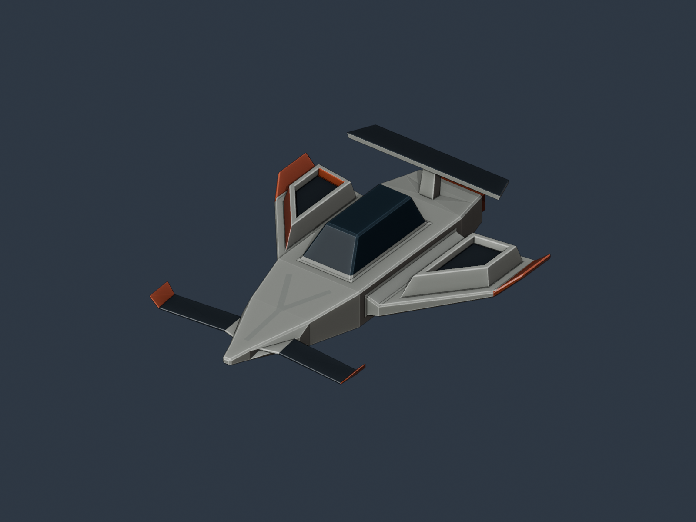

# Nave Aster R

Nave espacial inspirada en la Fórmula 1 y Star Wars, con una **Y discreta integrada en el morro**. Modelada en Blender a partir de un único cubo.

## Archivos de entrega

- [Nave_Aster.obj](Nave_Aster.obj): modelo exportado y triangulado.
- [Nave_Aster.mtl](Nave_Aster.mtl): materiales de color base simple. Mantenerlo en la misma carpeta que el OBJ.
- [Nave_Aster.png](Nave_Aster.png): captura del modelo desde el viewport de Blender.

Para descargar todo junto, usar **Code → Download ZIP**.

## Modelado y verificación

- Un solo objeto y una sola malla conectada, derivada del cubo inicial.
- Herramientas de modelado: Move, Scale, Extrude, Inset, Bevel y Knife.
- Modificador Triangulate aplicado antes de exportar.
- **557 vértices y 1,110 triángulos**; ninguna cara de más de tres vértices.
- Malla cerrada, sin aristas no manifold ni caras degeneradas.
- Cinco materiales de color base simple, sin texturas externas.
- Exportación OBJ con Y hacia arriba y −Z al frente.
